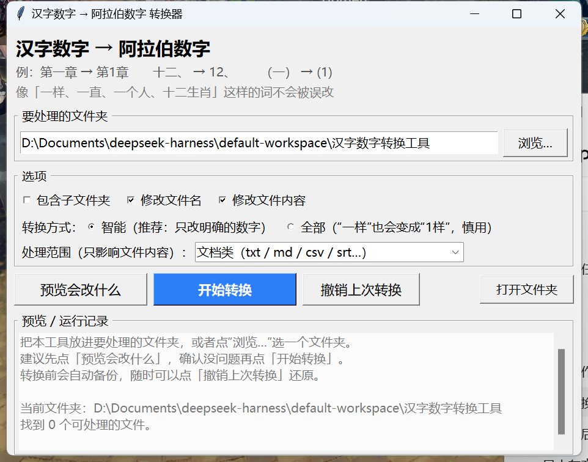

# CNumTool

> 把文件夹里所有文本文件的内容、以及所有文件名中的汉字数字，批量换成阿拉伯数字。



一个小巧的 Windows 桌面工具，用来收拾那些「第一章」「十二、」「（三）」「一百零五」——
把它们一次性变成「第1章」「12、」「（3）」「105」，文件里的内容能改，文件名也能改。

## 效果

| 原文 | 转换后 |
| --- | --- |
| 第一章 总则 | 第1章 总则 |
| 十二、 | 12、 |
| （三）附则 | （3）附则 |
| 一百零五 | 105 |
| 二〇二六年 | 2026年 |
| 第十二集.srt（文件名） | 第12集.srt（文件名） |

## 为什么不把所有「一二三」都换掉

因为中文里太多「数字」其实不是数字：

```
一样   一直   一个人   十二生肖   十分   万一   千万
```

无脑替换会变成「1样」「1直」「1个人」「12生肖」，把文章改坏。
所以默认的**智能模式**只在有把握的地方动手：

- 数字后面跟着「第」「共」「约」「近」这类词，比如 **第**十二章、**共**三章；
- 数字后面跟着量词或编号单位，比如十二**章**、第三**单元**、五**页**、六**号**；
- 数字两头都是标点、空格、行首行尾这类边界，比如 `一、`、`（十二）`、`十二 `。

「一样」「一直」「一个人」「十二生肖」「十分」「万一」这些词会被原样保留。
如果你确认文件里全是编号，可以切到**全部**模式，那时才会无差别替换。

## 功能

- 批量替换**文件内容**里的汉字数字（默认只处理文档类文本文件，避免改到程序源码）
- 批量替换**文件名**里的汉字数字
- 智能 / 全部 两种转换力度
- 转换前**自动备份**，随时**一键撤销**
- 自动识别 UTF-8、带 BOM 的 UTF-8、UTF-16、GBK 编码，并按**原编码**写回，不乱码
- 图片、压缩包、exe、视频等二进制文件自动跳过；程序自身文件永远不会被改

## 快速开始

### 方式一：双击使用（推荐）

1. 下载本仓库（右上角 `Code` → `Download ZIP`）并解压；
2. 把整个 `CNumTool` 文件夹复制到你想要处理的文件夹里（或者放任意位置，打开后再选文件夹）；
3. 双击 `双击启动.bat`，点「预览会改什么」确认，再点「开始转换」。

### 方式二：源码运行

```bash
python 汉字数字转换.py
```

### 方式三：命令行（不弹界面）

```bash
python 汉字数字转换.py --convert "D:\某个文件夹"
```

可选参数：

| 参数 | 说明 |
| --- | --- |
| `--all` | 用「全部」模式，更激进 |
| `--any-file` | 什么后缀都按文本处理 |
| `--sub` | 包含子文件夹 |
| `--no-rename` | 只改内容，不改文件名 |
| `--no-content` | 只改文件名，不改内容 |
| `--quiet` | 少打印一些 |

## 环境要求

- Windows 10 / 11
- Python 3.8+（含 tkinter，官方安装包自带）

## 支持的文件类型

| 类别 | 后缀 | 改内容 | 改文件名 |
| --- | --- | --- | --- |
| 文档类（默认处理） | `.txt` `.md` `.csv` `.tsv` `.srt` `.ass` `.vtt` `.log` `.json` `.html` `.xml` `.yaml` `.ini` … | ✅ | ✅ |
| 代码类（需手动开启） | `.py` `.js` `.css` `.java` `.c` `.cpp` `.cs` `.go` `.rs` `.sql` … | ✅ | ✅ |
| 其他 | `.docx` `.xlsx` `.pdf` `.jpg` `.zip` `.exe` … | ❌ 跳过 | ✅ |

> Word / Excel / PDF 的**内容**暂不支持（需要的话可以提 issue）。
> 注意：这一类文件只改名字，不改内容。

## 安全设计

1. **先预览**：点「预览会改什么」，会列出每个文件第几行、从什么改成什么，此时不动任何文件；
2. **自动备份**：真正转换前，会在原文件夹里生成 `_汉字数字转换备份_时间` 文件夹，保存全部原始文件；
3. **一键撤销**：「撤销上次转换」会把文件名和内容全部还原。

**请不要手动删除备份文件夹**，删了就没法撤销了。

## 常见问题

**双击 .bat 提示找不到 Python？**
安装 [Python 3](https://www.python.org/downloads/)，安装时勾选 *Add python.exe to PATH*。

**转换后文件乱码？**
本程序按检测到的原编码写回。如果仍出现乱码，请先「撤销上次转换」，然后带样例文件提 issue。

**预览显示「没有发现需要修改的内容」？**
换一下「处理范围」，或者确认数字写法是否属于上面说的「有把握」的情况。

## 许可证

[MIT](LICENSE)
